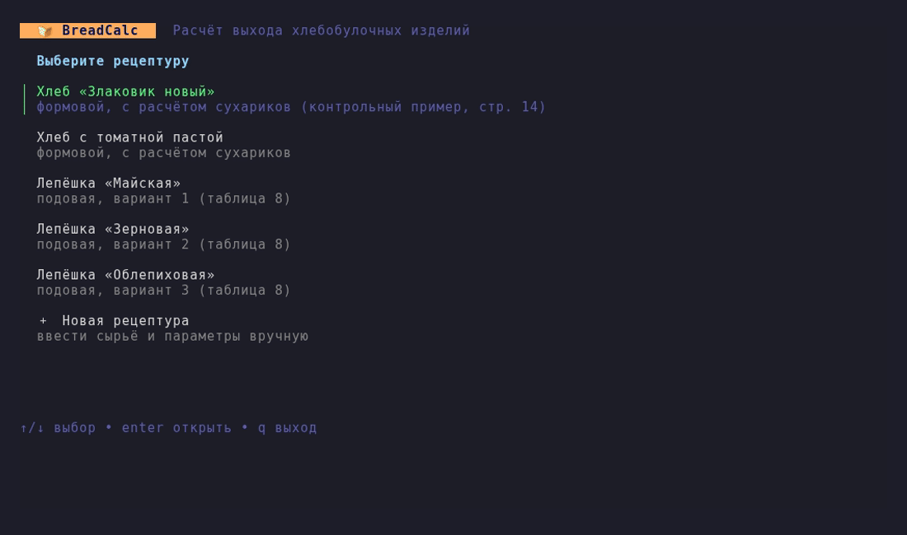
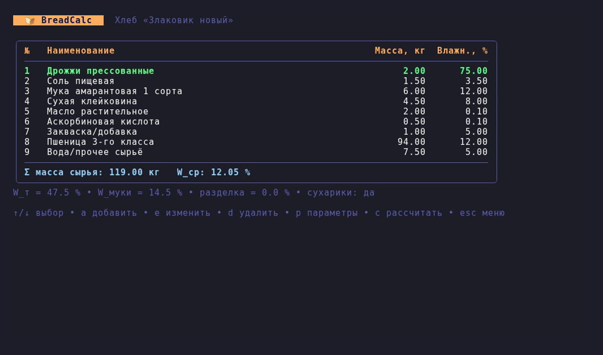
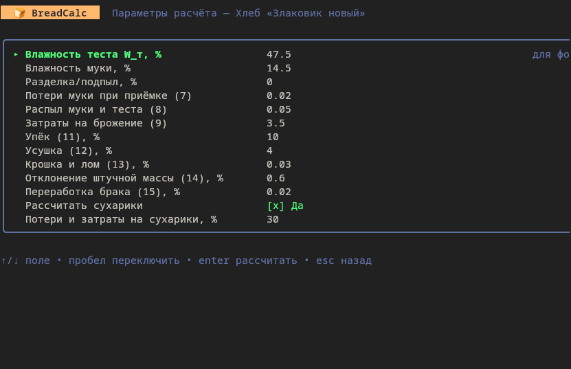
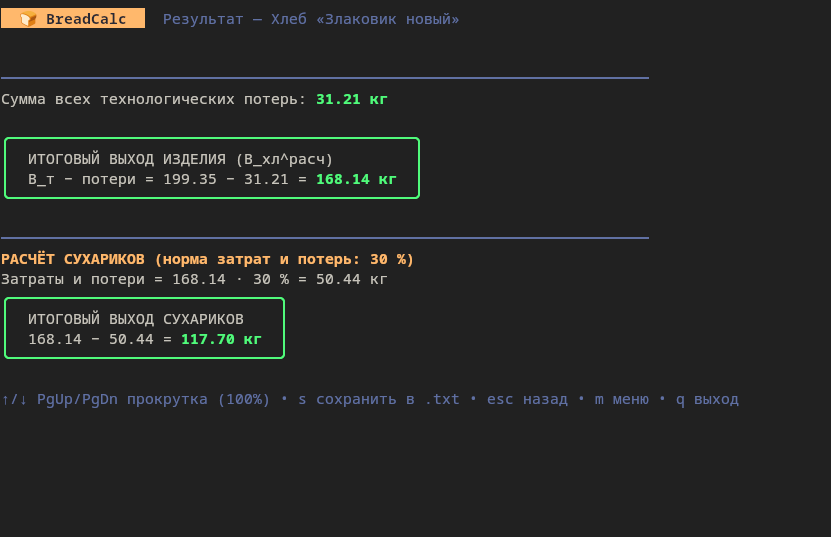

# BreadCalc

Консольное приложение на Go ([Bubble Tea](https://github.com/charmbracelet/bubbletea))
для расчёта выхода хлебобулочных изделий по формулам методички.



## Возможности

- Готовые рецептуры: хлеб «Злаковик новый», хлеб с томатной пастой, лепёшки «Майская», «Зерновая», «Облепиховая».
- Ввод собственной рецептуры: добавление, изменение и удаление сырья с живым пересчётом Σ массы и средневзвешенной влажности.
- Настройка нормативных параметров (влажность теста и муки, упёк, усушка, потери и т. д.).
- Пошаговый отчёт с подстановкой чисел в каждую формулу и сохранение в `.txt`.
- Опциональный расчёт выхода сухариков.

| Рецептура | Параметры | Результат |
|---|---|---|
|  |  |  |

## Ограничения

- Набор формул по умолчанию — методичка (4)–(15). Его можно менять и дополнять в программе; кнопка `r` на экране формул возвращает методичку.
- Рецептуры и параметры не сохраняются между запусками (сохраняется только текстовый отчёт).
- Формула (9) (затраты на брожение) реализована по числовой подстановке из методички и содержит константы 0.95, 0.7 и 1.96.

## Свои формулы и параметры

Меню → «⚙ Формулы и параметры» (или клавиша `f` на экране рецептуры). Вкладки переключаются клавишей `tab`.

- **Параметр** — именованное число (норма, коэффициент): имя, название, единица, значение по умолчанию. Перед каждым расчётом значения можно менять на экране «Параметры».
- **Формула** — имя, название, выражение, единица. Формулы могут ссылаться на параметры и друг на друга в любом порядке: порядок вычисления программа определяет сама.
- **Итоговый результат** — формула, которая выделяется рамкой в отчёте.
- **Группа** — формула считается только если группа включена (так устроены «Сухарики»).

Что можно писать в выражении: числа (десятичная точка), имена, `+ - * / ^`, скобки, сравнения `< <= > >= == !=`, функции `abs sqrt ln exp pow min max round floor ceil` и `if(условие; то; иначе)`. Системные имена: `Mc` (масса сырья), `SumMW` (Σ масса·влажность), `Cnt` (число видов сырья). Имена чувствительны к регистру и могут быть кириллическими.

Формула **не сохранится**, пока не пройдёт проверку: неизвестное имя (с подсказкой «имелось в виду …»), синтаксическая ошибка, циклическая зависимость, обращение к формуле из чужой группы, деление на ноль на текущей рецептуре. Параметр или формулу, которые используются в других формулах, удалить нельзя.

Модель хранится в текстовом файле (путь показан внизу экрана формул; если в папке запуска лежит `breadcalc-model.txt`, используется он). Файл можно править в блокноте; при каждом сохранении из программы прежняя версия остаётся в `.bak`:

```
param   Kz = 1.05 | | Коэффициент запаса | note=необязательная подсказка
formula Plan = Bres * Kz | кг | План выпуска | ref=(20) | group=Сухарики | final=1
```

Если файл содержит ошибки, программа запускается со встроенной моделью и не перезаписывает файл сама.

## Запуск

Нужен Go 1.21 или новее.

```
go mod tidy
go run .
```

Сборка исполняемого файла:

```
# Linux / macOS
go build -ldflags "-s -w" -o breadcalc .

# Windows (PowerShell)
go build -ldflags "-s -w" -o breadcalc.exe .

# Windows-сборка с Linux или macOS
GOOS=windows GOARCH=amd64 go build -ldflags "-s -w" -o breadcalc.exe .
```

Готовые сборки для Windows и Linux можно скачать в разделе **Releases**.
Для комфортного отображения кириллицы и рамок используйте Windows Terminal; в старом `cmd.exe` предварительно выполните `chcp 65001`.

## Управление

| Экран | Клавиши |
|---|---|
| Меню | `↑/↓` выбор, `enter` открыть, `q` выход |
| Рецептура | `a` добавить, `e` изменить, `d` удалить, `p` параметры, `c` рассчитать, `esc` назад |
| Параметры | `↑/↓` поле, `пробел` переключить сухарики, `enter` рассчитать, `esc` назад |
| Результат | `↑/↓`, `PgUp/PgDn` прокрутка, `s` сохранить отчёт, `m` меню, `q` выход |

## Структура проекта

| Файл | Назначение |
|---|---|
| `main.go` | интерфейс (Bubble Tea) |
| `calc.go` | сырьё рецептуры и его итоги |
| `report.go` | формирование отчёта |
| `recipes.go` | готовые рецептуры |
| `engine/` | расчётное ядро: разбор и проверка выражений, модель, файл (без зависимостей от интерфейса) |
| `engine/default_model.txt` | встроенные формулы методички |
| `*_test.go` | тесты: сверка с эталонными значениями исходного скрипта, проверка «плохих» формул, сценарии интерфейса |

Тесты: `go test ./...`

## Планы

- Сохранение и загрузка рецептур.
- Экспорт отчёта в Markdown и docx.
- Неинтерактивный режим (`breadcalc calc --recipe файл`) и вывод в json/csv.
- Редактор формул: переименование с автоматической заменой во всех выражениях.
